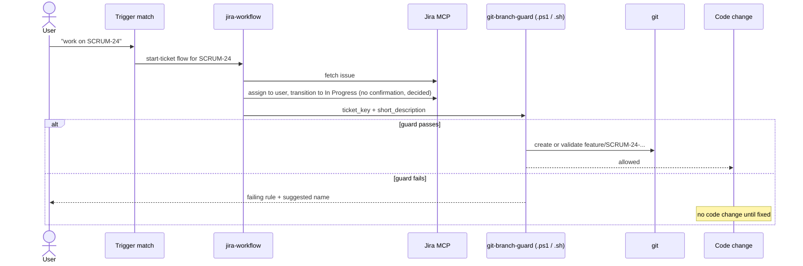
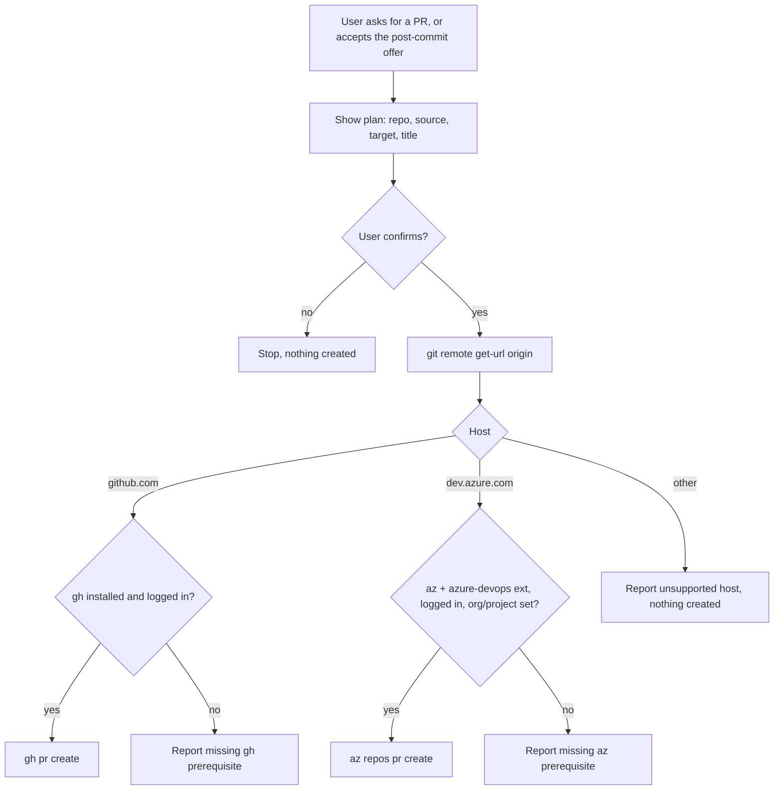
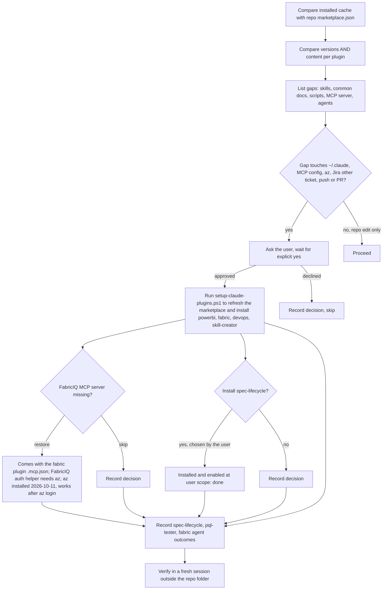
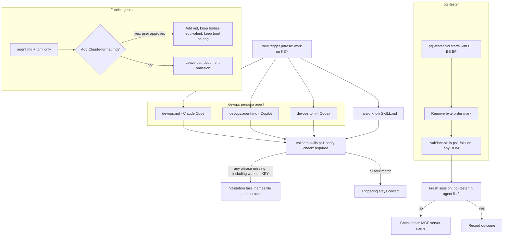

## Context

"work on <KEY>" is not in the documented start-ticket trigger list in `jira-workflow` Step 2 or in `devops.agent.md`, so the request may not route to the Jira workflow. The guard and Jira steps are documented as sequential, but nothing forces the branch step to wait for the guard. The PR path (`assets/create_pr.ps1`, `assets/create_pr.sh`) calls only `az repos pr create`, but the repo's origin is GitHub. The devops persona agent ships in three dialects that must stay equivalent. `pql-tester.md` starts with a byte order mark and is missing from the agent list. The Fabric agents have no Claude-format file. The installed plugin cache is stale and the guard script there is a `.txt`.

## Goals / Non-Goals

**Goals**

- A plain "work on SCRUM-24" reliably runs `jira-workflow` first, then `git-branch-guard`, then any code change.
- PR creation works for both GitHub (`gh`) and Azure DevOps (`az`) remotes, chosen from the origin host.
- Installed plugins under `~/.claude` match the repo versions and content, after approval.
- Every agent file Claude Code should load parses, and the devops agent dialects stay identical.

**Non-Goals**

- Changing the Jira MCP server or its tool contract.
- Changing the protected-branch list or the `[A-Z]+-\d+` key rule.

## Decisions

### Decision: Add "work on <KEY>" to the start trigger list in every dialect and the skill

The trigger list is duplicated in `plugins/devops/skills/jira-workflow/SKILL.md` (Step 2) and in the devops agent's three dialects (`devops.md`, `devops.agent.md`, `devops.toml`). All four get the phrase, so the skill and every dialect match the same text. The spec in `specs/devops/jira-work-trigger/` is the source of truth.

Alternative considered: rely on the model to infer intent from "work on". Rejected, because the trigger list is the documented contract and inference is not testable.

### Decision: Make the guard a hard gate in the start-ticket flow

Step 2.6 in `jira-workflow` already hands off to `git-branch-guard`. The change makes the handoff explicit: no branch creation or switching happens in the trigger handler itself, and implementation waits for the guard to pass.

### Decision: Detect the PR host from `git remote get-url origin`

`create_pr.ps1` and `create_pr.sh` parse the origin URL. `github.com` routes to `gh pr create`; `dev.azure.com` keeps `az repos pr create`; any other host reports unsupported. Detection is by URL, not by installed CLI, so a GitHub repo never reports a missing `az`.

Alternative considered: try `gh` first, then `az`. Rejected, because it can create a PR on the wrong host when both CLIs are logged in.

### Decision: Ship the guard as `.ps1` and `.sh`, never `.txt`

The repo already has `check_git_branch_guard.ps1` and `.sh`. The `.txt` copy exists only in the stale 0.1.0 cache, and PowerShell cannot run it with `-File`. The refresh replaces the cached copy, and the `.github` prompt now points to the real scripts.

### Decision: Compare plugin content, not only version numbers

`fabric` is installed at 0.2.0, the same number as the repo, but only fabric-cli is present. A version-only check would call it current. The refresh compares skill lists and files per plugin, and checks `skill-creator` the same way.

### Decision: Restore the FabricIQ HTTP MCP server only with approval

Restoring it is an MCP configuration change. The refresh lists it as a finding and asks before touching MCP config.

### Decision: Keep approval gates outside the automated path

Changes under `~/.claude`, plugin folder replacement, `az` install, MCP config, Jira writes on other tickets, pushes, and PRs all stop for an explicit yes. Repo edits proceed without asking.

### Decision: Treat the `pql-tester` byte order mark as the likely load failure

`plugins/powerbi/agents/pql-tester.md` begins with `EF BB BF`; every other agent Markdown file begins with `---`. A leading mark prevents frontmatter parsing, which matches the symptom (file in cache, agent absent from the list). The fix is to remove the mark in the repo and add a check to `tools/validate-skills.ps1`. This stays a hypothesis until the agent appears in a fresh session's agent list after the refresh.

Alternative considered: wrong tool name. The agent's `tools:` line lists `mcp__powerbi-modeling-mcp`, while this machine exposes the server under a plugin-prefixed name. Kept as a second suspect to check if the BOM fix does not resolve it.

### Decision: Edit all agent dialects together, and enforce it with a validator check

The devops persona agent ships as `devops.md` (Claude Code), `devops.agent.md` (Copilot), and `devops.toml` (Codex). `repo-tooling/claude-code-packaging` requires equivalent bodies in the same edit, and `codex-plugin-compatibility` requires one `.toml` per agent Markdown file. The trigger change therefore touches all three plus the skill, and the spec requires identical phrases across them. `tools/validate-skills.ps1` enforces this: it fails when any dialect or the skill omits a start-ticket phrase, and when "work on <KEY>" is missing anywhere. This check is what keeps triggering correct over time.

### Decision: Add Claude-format Fabric agents only if the user approves

`FabricDataEngineer` and `FabricMigrationEngineer` have `.agent.md` and `.toml` only. Adding `.md` versions makes them loadable in Claude Code but adds files that must stay equivalent to the other dialects. The packaging spec requires the `.md` only for agents published to Claude Code and requires a recorded omission otherwise, so the change records the user's choice instead of assuming one. If added, bodies stay equivalent to the `.agent.md` and the one-to-one `.toml` pairing holds.

### Decision: Refresh the install through `setup-claude-plugins.ps1`

The repo already provides `setup-claude-plugins.ps1`, which registers or refreshes `.claude-plugin/marketplace.json` and installs all or one named plugin. Using it reproduces a supported install instead of hand-copying files into `~/.claude`, and it picks up each plugin's `plugin.json` version. It still changes `~/.claude`, so it waits for approval.

### Decision: Record the `spec-lifecycle` and `pql-tester` outcomes in the change

Installing `spec-lifecycle` and fixing `pql-tester` loading change `~/.claude` state, so they wait for approval. The change records the chosen outcome, whether install or documented failure, in tasks.md.

## Open Questions

- ~~**Jira confirmation.**~~ Resolved by the user: "work on <KEY>" assigns the ticket and moves it to In Progress automatically. Comments and writes on other tickets still ask first.
- **Fabric agents.** Add Claude-format `.md` versions, or leave them out. If added, each needs its dialect-equivalent body and keeps the one-to-one `.toml` pairing.
- **pql-tester cause.** If removing the byte order mark does not make the agent load, check the `tools:` MCP server name next.
- ~~**spec-lifecycle.**~~ Resolved: installed and enabled at user scope on 2026-10-11 at the user's request (task 3.6).

## Architecture Diagram

### 1. "work on <KEY>" start flow

### 2. PR creation by host

### 3. Install refresh and approval gates

### 4. Agent updates

## Risks / Trade-offs

- Trigger lists are duplicated, so they can drift. Mitigation: the spec is the source of truth, and the test plan checks both files.
- URL-based host detection misses unusual remote hosts. Mitigation: unknown hosts are reported as unsupported, not guessed.
- The change edits the `~/.claude` install, which affects every project on this machine. Mitigation: the install step waits for explicit approval and uses the supported `setup-claude-plugins.ps1`.
- The fabric plugin's `.mcp.json` registers two MCP servers when the plugin loads: `fabric-mcp-server` (runs `npx -y @microsoft/fabric-mcp@latest`) and `FabricIQ` (HTTP, auth via `az account get-access-token`). So `az` is also needed for FabricIQ, not only for Azure DevOps PRs. Mitigation: `az` is now installed (task 5.4), so FabricIQ works once the user runs `az login`; documented in tasks 3.3 and 5.1; the user can disable the servers if unwanted.
- The byte order mark may not be the only reason `pql-tester` fails to load. Mitigation: task 4.4 checks in a fresh session and falls back to the `tools:` MCP name.
- The trigger-phrase parity check in `tools/validate-skills.ps1` adds validator scope. It is required, not optional: it is what guarantees "work on <KEY>" triggers `jira-workflow` in every dialect, so a future edit to one file cannot silently break triggering.
- Adding Claude-format Fabric agents adds files that must stay equivalent to the other dialects. Mitigation: only added with approval.
